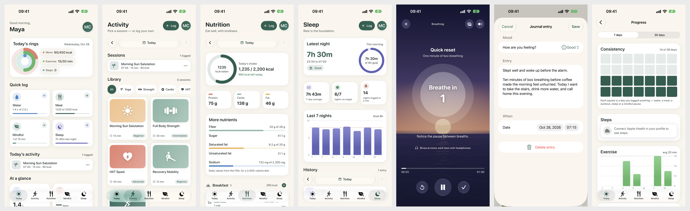

# Vitala — Healthy living, gently

A calm iPhone companion for movement, food, water, sleep, mindful breathing and journaling. Private by design: no account, no servers, everything on the device, with optional Apple Health sync.

Author: Andres Zubizarreta

**[▶ Try the live demo](https://appetize.io/app/b_cvskuwfinwn5sb6wt2okkj3gja)** — runs Vitala in your browser, no install needed.

<p align="center">
  
</p>

## Features

- **Today** — Move, Exercise and Steps rings against your own goals; one-tap logging for water, meals, mindful minutes and sleep; real streaks and weekly workout progress.
- **Activity** — guided yoga, strength, HIIT, mobility and running sessions with per-exercise countdowns; log any activity with type, duration, energy and distance.
- **Nutrition** — search hundreds of thousands of foods from USDA FoodData Central with real portions ("1 banana", "2 Tbsp"), scan barcodes (VisionKit, with USDA and Open Food Facts lookup), plus custom and recent foods that work offline; a calorie target suggested from your profile (Mifflin–St Jeor × activity). Protein, carbs and fat for the day, plus a **More nutrients** card for fiber, sugar, saturated and unsaturated fat and sodium, with bars against FDA daily values. Meals list each food by its full name with brand and the amount eaten. Tap a food for its nutrition (calories, macros and their share of calories, sugar, sodium, and saturated, monounsaturated, polyunsaturated and trans fat), or tap Breakfast, Lunch, Dinner or Snack for that meal's totals. Nutrients a label doesn't give show as "Not listed", never as zero. Food logged in other apps appears alongside your meals through Apple Health.
- **Mindful** — nine guided breathing sessions, each with its own rhythm:
  - **Cues:** themed messages for each kind of session (breathing, focus, sleep, stress, gratitude) plus lines written for each session, shuffled every time and changing every 20 seconds.
  - **Sound**, synthesised live on the device: Spa, binaural & bowls (the default every session starts on), Spa & binaural, Spa, Crystal bowls, Ocean or Silent.
  - **Scenes**, drawn live behind the guide: ocean at dusk, rain on water, starry night, misty mountains or aurora. Every session opens on the scene that matches its kind and can switch for that session.
  - **Haptics** that build through each in-breath (taps gently quicken and strengthen) and ease off through each out-breath, with an on/off switch in the sound menu.
  - A completion screen saves the session and offers to write about it.
- **Journal** — write an entry any time or right after a session: pick a mood from a menu (Great, Good, Calm, Okay, Tired, Anxious, Stressed, Sad, Frustrated), write freely, and set the date. Browse entries day by day, edit or delete them; entries written after a session link back to it.
- **Sleep** — bedtime, wake time and quality with validation, a 7-night chart and history. Nights recorded by Apple Watch, the iPhone sleep schedule or other apps appear automatically, counted by time actually asleep.
- **Progress** — 7- and 30-day trends for steps, exercise, food, water, sleep and mindful minutes; a 28-day consistency grid.
- **Profile** — reachable from every tab; optional profile photo; goals; reminders with per-reminder times; export to JSON (including journal entries); erase all data.
- **Apple Health** — reads steps, energy, exercise, distance, heart rate, sleep, mindful minutes and the food energy, protein, carbs and fat other apps record; writes water, sleep, mindful sessions and workouts, with edits and deletes kept in sync. The last 30 days of sleep and nutrition from other apps show read-only next to what you log.

## Design and accessibility

- Native **Liquid Glass** on iOS 26 and later — tab bar, buttons, filter chips, players, keyboard bar and scroll-edge effects — with a material fallback on iOS 17–25.
- Layered **Icon Composer** app icon that iOS renders as glass in Light, Dark, Clear and Tinted.
- Every text colour meets **WCAG AA** in Light and Dark (enforced by `ContrastTests`).
- **Dynamic Type** everywhere, with layouts that reflow at accessibility sizes; **VoiceOver** labels, headers, custom actions, Audio Graph chart descriptions and spoken breathing phases; 44 pt targets; **Reduce Motion** respected (breathing scenes hold still).
- UI tests run Xcode's **accessibility audit** on every main screen at default and large text sizes.

## Requirements

- Xcode 26 or later (built and tested with Xcode 27.1)
- iOS 17.0+ deployment target, iPhone only for 1.0

## Getting started

1. Open `Vitala.xcodeproj`.
2. Vitala target → **Signing & Capabilities**: the project is set to the author's team, so pick your own Team to run it on a device (HealthKit requires a paid developer account). Leave the HealthKit capability's extra options (Clinical Health Records, Background Delivery) off: Vitala doesn't use them.
3. **Food search key (optional for development):** copy `Config/Secrets.example.xcconfig` to `Config/Secrets.xcconfig` and paste your [USDA FoodData Central key](https://fdc.nal.usda.gov/api-key-signup) after `USDA_API_KEY =`. Git ignores `Secrets.xcconfig`. Without a key, Debug builds use USDA's shared `DEMO_KEY` and Release builds hide online search.
4. Run on an iPhone simulator or device.

The project uses folder-synchronised groups, so new files in `Vitala/`, `VitalaTests/` or `VitalaUITests/` are picked up automatically.

### Handy launch arguments (Debug builds only)

| Argument | Effect |
|---|---|
| `-resetData` | Start from a clean first-launch state |
| `-seedSampleData` | Skip onboarding and load two weeks of realistic logs |
| `-greetingHour 9` | Greet as if it were that hour (used for screenshots) |

Add them in **Product › Scheme › Edit Scheme › Run › Arguments**. They're compiled out of Release builds.

## Tests

```bash
xcodebuild test -project Vitala.xcodeproj -scheme Vitala \
  -destination 'platform=iOS Simulator,name=iPhone 17'
```

- `VitalaTests` (Swift Testing): storage and migration, journal entries, Health sync helpers, grouping Health sleep into nights and food into meals, insights and streaks, calorie suggestion, units, nutrition grouping and detailed-nutrient totals, food search and barcode parsing, export, profile photos, colour contrast, offline rendering of every ambient sound (including that each one sounds distinct and never clips), breathing haptic patterns, scene choice, and the breathing cue pools and shuffle.
- `VitalaUITests`: launch test, accessibility audits on every main screen and form (including the journal), and food search. `ScreenshotTests` regenerates App Store screenshots (see `docs/APP_STORE.md`). Live network tests run only with `TEST_RUNNER_VITALA_NETWORK_TESTS=1`.

## Project structure

```
Vitala/
├── App/            App entry, root routing, tab bar, app info, debug launch options
├── DesignSystem/   Colours, type ramp, glass helpers, brand mark, chart accessibility, components
├── Features/       Onboarding, ProfileSetup, Dashboard, Activity, Nutrition, Water, Sleep,
│                   Mindfulness, Progress, Settings
├── Models/         Profile and goals, workouts, meals, water, sleep, mindfulness and its
│                   cues, journal
├── Services/       DataStore, ProfileStore, SecureFileStore, HealthKitService,
│                   NotificationService, AmbientSoundPlayer, BreathHaptics, FoodDatabase,
│                   BarcodeLookup, Insights, DataExport, Units, Theme
├── ViewModels/     AppState (top-level routing and tabs)
└── Resources/      Info.plist, entitlements, privacy manifest, assets, AppIcon.icon
docs/               Release plan, App Store kit, privacy policy, support page, screenshots
```

## Architecture notes

- **Local-first storage.** `DataStore` and `ProfileStore` persist JSON (and the profile photo) through `SecureFileStore`: atomic writes in Application Support with iOS Data Protection. A file that exists but can't be read is never overwritten. Pre-1.0 `UserDefaults` data migrates once on first launch.
- **Apple Health sync.** `DataStore` mirrors every log into Health. Samples carry a sync identifier derived from the entry's id, so edits replace and deletes remove — no duplicates.
- **Apple Health import.** `HealthKitService` reads recent sleep and nutrition written by other apps, skipping Vitala's own samples, and groups them into nights and meals. `DataStore.allSleep` and `allMeals` merge them with local logs; a night logged in Vitala wins over an overlapping Health night. Imported entries are never stored or written back.
- **Insights.** Streaks, weekly counts and daily totals are pure functions in `Insights`, shared by Today, Profile and Progress.
- **Nutrition data.** Foods keep sugar, sodium and each kind of fat as optional values: nil means the source didn't list it, so totals say "Not listed" rather than showing a false zero, and foods saved before these fields existed still load.
- **Sound.** `AmbientSoundPlayer` renders audio in real time with `AVAudioEngine`; the render loop never allocates or locks. Audio session changes run on one background queue shared by every player, which counts who is using the session, so the UI never waits on the hardware and a session closing never silences one that just opened.
- **Scenes.** `ZenBackground` draws each scene in a SwiftUI `Canvas`: the still backdrop once, the moving parts 20 times a second, with any soft glow applied as a GPU blur on the layer rather than per frame.
- **Haptics.** `BreathHaptics` plays one Core Haptics pattern per breathing phase, built from pure functions so the patterns are unit-tested; it rejoins mid-breath after a pause, a return from the background or being switched back on.
- **Breathing player.** The countdown redraws four times a second, so the background, scene menu and sound menu are `Equatable` views that only redraw when their own inputs change; this keeps glass menus from being rebuilt mid-tap.

## Release

See [`docs/APP_STORE.md`](docs/APP_STORE.md) for the submission checklist, listing copy, privacy answers and review notes, and [`docs/AGILE_PLAN.md`](docs/AGILE_PLAN.md) for the release plan and sprint log.

© 2026 Andres Zubizarreta
