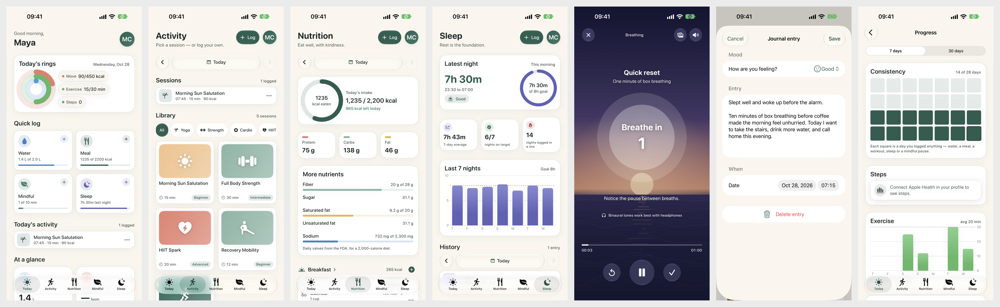

# Vitala — Healthy living, gently

A calm iPhone companion for movement, food, water, sleep, mindful breathing and journaling, with daily targets worked out for each person. You sign in with Apple, Google or email; everything you log stays on the device, with optional Apple Health and iCloud sync.

Author: Andres Zubizarreta

**[▶ Try the live demo](https://appetize.io/app/b_cvskuwfinwn5sb6wt2okkj3gja)** — runs Vitala in your browser, no install needed.

<p align="center">
  
</p>

## Features

- **Accounts** — Vitala needs an account: Sign in with Apple, Google, or an email address and password, with password reset, sign out and in-app account deletion. The account holds only the sign-in (Firebase Authentication); nothing that is logged is stored with it.
- **Today** — Move, Exercise and Steps rings against your own goals; one-tap logging for water, meals, mindful minutes and sleep; real streaks and weekly workout progress. **Your plan** shows the four figures your focus puts first against their targets, what the food target means for your weight each week, and your weight against its target.
- **Goals that follow you** — targets for food energy, protein, Move, steps, exercise, water, sleep and mindful minutes are worked out from your focus, sex, age, height, weight and activity level, and change when any of those do. Losing weight is a deficit of at most 500 kcal with a floor; steps are a distance counted in your stride. You can set your own instead.
- **Activity** — guided yoga, strength, HIIT, mobility and running sessions with per-exercise countdowns; log any activity with type, duration, energy and distance. Every exercise has a **looping demonstration**: a figure drawn in the app moves through it in the workout player (and pauses with it), and each exercise in a workout's list shows a still and opens a closer look with instructions. **Build your own workout** from the exercise library: pick exercises (the same one twice if you like), set each one's time or reps and sets, reorder them, and choose a type and level; its length and energy are worked out for you, and it can be edited or deleted later.
- **Nutrition** — search hundreds of thousands of foods from USDA FoodData Central with real portions ("1 banana", "2 Tbsp"), scan barcodes (VisionKit, with USDA and Open Food Facts lookup), plus custom and recent foods that work offline. **Restaurant meals:** type a chain's name, or pick it from the row under the search field, to list its menu (20 chains USDA covers, among them McDonald's, Wendy's, Burger King, Taco Bell, KFC and Subway); restaurant items are labelled with their chain and log by the item, not per 100 g. **Favourites and saved meals:** star any food to list it first; save the foods in a meal under a name ("My usual breakfast") and log them again in one tap; an empty meal offers what you ate for it yesterday. Also a calorie target suggested from your profile (Mifflin–St Jeor × activity). Protein, carbs and fat for the day, plus a **More nutrients** card for fiber, sugar, saturated and unsaturated fat and sodium, with bars against FDA daily values. Meals list each food by its full name with brand and the amount eaten. Tap a food for its nutrition (calories, macros and their share of calories, sugar, sodium, and saturated, monounsaturated, polyunsaturated and trans fat), or tap Breakfast, Lunch, Dinner or Snack for that meal's totals. Nutrients a label doesn't give show as "Not listed", never as zero. Food logged in other apps appears alongside your meals through Apple Health. **GLP-1 tracker:** log each dose (medicine, amount, time and injection site), see the last dose and when the next is due, and note side effects with their strength; ten medicines are listed and any other can be typed in. It records only: no doses are suggested.
- **Mindful** — nine guided breathing sessions, each with its own rhythm:
  - **Cues:** themed messages for each kind of session (breathing, focus, sleep, stress, gratitude) plus lines written for each session, shuffled every time and changing every 20 seconds.
  - **Sound**, synthesised live on the device: Spa, binaural & bowls (the default every session starts on), Spa & binaural, Spa, Crystal bowls, Ocean or Silent. Switching crossfades from one to the next.
  - **Scenes**, drawn live behind the guide: ocean at dusk, rain on water, starry night, misty mountains or aurora. Every session opens on the scene that matches its kind and can switch for that session.
  - **Haptics** that build through each in-breath (taps gently quicken and strengthen) and ease off through each out-breath, with an on/off switch in the sound menu.
  - **Screen locked:** a session's sound carries on when you lock the iPhone, and its clock keeps time; it is saved when it ends. A paused or silent session waits instead.
  - **Live Activity:** the Lock Screen and Dynamic Island show whether to breathe in, hold or breathe out, a ring that fills and empties with the breath, and the time left. Workouts have one too: the exercise, its place in the workout and the running time.
  - A completion screen saves the session and offers to write about it.
- **Journal** — write an entry any time or right after a session: pick a mood from a menu (Great, Good, Calm, Okay, Tired, Anxious, Stressed, Sad, Frustrated), write freely, and set the date. Browse entries day by day, edit or delete them; entries written after a session link back to it. A strip above the entries shows the last seven days' moods.
- **Sleep** — bedtime, wake time and quality with validation, a 7-night chart and history. Nights recorded by Apple Watch, the iPhone sleep schedule or other apps appear automatically, counted by time actually asleep.
- **Progress** — 7- and 30-day trends for steps, exercise, food, water, sleep and mindful minutes; your recorded **weight** against its target; a **Mood** card with each day's journal mood from low to great, the moods chosen most often, and whether the period felt lighter or heavier than the one before; a 28-day consistency grid.
- **Profile** — reachable from every tab; optional profile photo; goals; reminders with per-reminder times; export to JSON (including journal entries); erase all data.
- **iCloud sync** — optional and off by default. Turn it on in Settings and logs, the journal, favourite foods, saved meals and built workouts match on every iPhone signed in to the same Apple Account, through the user's own private iCloud. The profile, goals and photo stay on each device.
- **Safe storage** — saving happens in the background. If the data file is ever damaged, Vitala sets it aside, carries on from the copy it saved at the last clean launch, tells you, and lets you send or delete the damaged file from Settings; one unreadable entry never costs the rest.
- **Apple Health** — reads steps, energy, exercise, distance, heart rate, sleep, mindful minutes and the food energy, protein, carbs and fat other apps record; writes water, sleep, mindful sessions and workouts, with edits and deletes kept in sync. The last 30 days of sleep and nutrition from other apps show read-only next to what you log.

## Design and accessibility

- Native **Liquid Glass** on iOS 26 and later — tab bar, buttons, filter chips, players, keyboard bar and scroll-edge effects — with a material fallback on iOS 17–25.
- Layered **Icon Composer** app icon that iOS renders as glass in Light, Dark, Clear and Tinted.
- Every text colour meets **WCAG AA** in Light and Dark (enforced by `ContrastTests`).
- **Dynamic Type** everywhere, with layouts that reflow at accessibility sizes; **VoiceOver** labels, headers, custom actions, Audio Graph chart descriptions and spoken breathing phases; 44 pt targets; **Reduce Motion** respected (breathing scenes hold still).
- UI tests run Xcode's **accessibility audit** on every main screen at default and large text sizes.

## Requirements

- Xcode 26 or later (built and tested with Xcode 27.2)
- iOS 17.0+ deployment target, iPhone only for 1.0

## Getting started

1. Open `Vitala.xcodeproj`.
2. Vitala target → **Signing & Capabilities**: the project is set to the author's team, so pick your own Team to run it on a device (HealthKit and iCloud require a paid developer account). Leave the HealthKit capability's extra options (Clinical Health Records, Background Delivery) off: Vitala doesn't use them. Under **iCloud**, CloudKit should be ticked with a container named `iCloud.` plus the bundle ID; if it is red or missing, press refresh or **+** so Xcode creates it, or device builds won't sign. The simulator needs none of this.
3. **Accounts (optional for development):** with no keys set, Debug builds keep accounts on the device and check nothing, so you can run the app straight away; the sign-in screen says so. For real accounts, create a Firebase project, enable Email/Password, Google and Apple under Authentication, and copy `API_KEY` and `CLIENT_ID` from its `GoogleService-Info.plist` into `Config/Secrets.xcconfig` as `FIREBASE_API_KEY` and `GOOGLE_CLIENT_ID` (see `docs/APP_STORE.md`, step 3c). Release builds can't sign anyone in without them.
4. **Food search key (optional for development):** copy `Config/Secrets.example.xcconfig` to `Config/Secrets.xcconfig` and paste your [USDA FoodData Central key](https://fdc.nal.usda.gov/api-key-signup) after `USDA_API_KEY =`. Git ignores `Secrets.xcconfig`. Without a key, Debug builds use USDA's shared `DEMO_KEY` and Release builds hide online search.
5. Run on an iPhone simulator or device.

The project uses folder-synchronised groups, so new files in `Vitala/`, `VitalaTests/`, `VitalaUITests/`, `VitalaWidgets/` (the Live Activity's widget extension) or `VitalaShared/` (code built into both the app and the extension) are picked up automatically.

### Adding filmed exercise clips (optional)

Exercises are demonstrated by a figure drawn in the app. To show filmed footage instead, add a clip to the `Vitala/` folder named after the exercise in lowercase with hyphens: `goblet-squat.mp4`, `plank-to-up-dog.mp4`, `childs-pose.mp4` (`.mp4`, `.mov` or `.m4v`). The workout player and the exercise's closer look then play it on a loop, without sound, in place of the figure. Use only footage you have the right to distribute.

### Handy launch arguments (Debug builds only)

| Argument | Effect |
|---|---|
| `-resetData` | Start from a clean first-launch state, signed out, with accounts kept on the device |
| `-seedSampleData` | Sign in as a sample account, skip onboarding and load two weeks of realistic logs |
| `-greetingHour 9` | Greet as if it were that hour (used for screenshots) |

Add them in **Product › Scheme › Edit Scheme › Run › Arguments**. They're compiled out of Release builds.

## Tests

```bash
xcodebuild test -project Vitala.xcodeproj -scheme Vitala \
  -destination 'platform=iOS Simulator,name=iPhone 17'
```

- `VitalaTests` (Swift Testing): storage and migration, journal entries, Health sync helpers, grouping Health sleep into nights and food into meals, insights and streaks, calorie suggestion, units, nutrition grouping and detailed-nutrient totals, food search and barcode parsing, restaurant names and menus, export, profile photos, colour contrast, offline rendering of every ambient sound (including that each one sounds distinct, never clips, and crossfades without a click), breathing haptic patterns, scene choice, the breathing cue pools and shuffle, the exercise demonstrations (limbs never stretch, planted hands and feet don't slide, every loop closes), damaged-file recovery and the background writer, the session clock, favourites and saved meals, the workout builder, mood trends, iCloud sync (the merge rules, and two simulated devices syncing through a stand-in for iCloud, including a save that races another device, failures and retries), accounts (sign up, sign in, sign out, deletion, who owns the data on a device, the requests sent to Firebase and Google and how their replies and errors are read), goal plans, the GLP-1 tracker, and what the Live Activity shows.
- `VitalaUITests`: launch test, accessibility audits on every main screen and form (including sign-in, creating an account, the journal, the workout builder and the iCloud sync screen), and food search. `ScreenshotTests` regenerates App Store screenshots (see `docs/APP_STORE.md`). Live network tests run only with `TEST_RUNNER_VITALA_NETWORK_TESTS=1`.

## Project structure

```
Vitala/
├── App/            App entry, root routing, tab bar, app info, debug launch options
├── DesignSystem/   Colours, type ramp, glass helpers, brand mark, chart accessibility, components
├── Features/       Auth, Onboarding, ProfileSetup, Dashboard, Activity, Nutrition, Water, Sleep,
│                   Mindfulness, Progress, Settings
├── Models/         Profile and goals, goal plan, workouts and exercise demonstrations, meals,
│                   GLP-1 doses and side effects, water, sleep, mindfulness and its cues,
│                   journal, change log
├── Services/       Auth (AuthService, FirebaseAuthBackend, identity providers, Keychain),
│                   DataStore, ProfileStore, SecureFileStore, CloudSync, SyncMerge,
│                   HealthKitService, NotificationService, AmbientSoundPlayer, BreathHaptics,
│                   SessionLiveActivityController, FoodDatabase, RestaurantFoods, BarcodeLookup,
│                   Insights, DataExport, Units, Theme
├── ViewModels/     AppState (top-level routing and tabs)
└── Resources/      Info.plist, entitlements, privacy manifest, assets, AppIcon.icon
VitalaWidgets/      Widget extension: the Live Activity's Lock Screen and Dynamic Island views
VitalaShared/       Code built into both the app and the extension (the activity's content)
docs/               Release plan, App Store kit, privacy policy, support page, screenshots
```

## Architecture notes

- **Accounts.** `AuthService` holds who is signed in and keeps the session in the Keychain. It talks to an `AuthBackend`: `FirebaseAuthBackend` calls Firebase Authentication's REST API directly, so there is no SDK to ship, and `LocalAuthBackend` stands in for it in tests and in development builds with no keys. Sign in with Apple uses the system button with a hashed nonce; Google uses the standard OAuth flow for installed apps (PKCE, no client secret) in the system's sign-in sheet. Deleting an Apple account first asks Apple to confirm, then revokes Vitala's access. The data on a device belongs to the first account to sign in there; another account is asked before it is erased.
- **Goal plans.** `GoalPlan` turns focus, sex, age, height, weight and activity level into daily targets with plain arithmetic: Mifflin–St Jeor energy at rest times the activity level, a capped deficit or small surplus, protein and Move per kilogram, steps as a distance divided by stride length. `ProfileStore` reapplies it whenever a profile that follows the plan is saved or loaded.
- **Live Activity.** `SessionActivityAttributes` (shared with the widget extension) describes a workout or breathing session as moments in time, so the system keeps clocks and rings moving without the app. The breathing player updates it at each change of phase, which it can do with the screen locked because its sound keeps the app running.
- **Local-first storage.** `DataStore` and `ProfileStore` persist JSON (and the profile photo) through `SecureFileStore`: atomic writes in Application Support with iOS Data Protection. Pre-1.0 `UserDefaults` data migrates once on first launch.
- **Saving.** `DataStore` hands each change to a `BackgroundSaver`, which encodes and writes off the main thread, folds changes made in quick succession into one write, and flushes when the app leaves the screen. Handing it the data is free however much is logged, because Swift arrays are shared until changed.
- **Damaged files.** A file whose bytes can't be read at all (before the first unlock after a restart) is left untouched and read again once the device unlocks. A file that reads but won't decode is moved aside, never deleted, and the store carries on from the copy it made at the last clean launch. Lists are decoded entry by entry (`Salvaged`), so a single bad entry is skipped and counted instead of failing the file. Either way the user is told once, and the set-aside file can be shared or deleted from Settings.
- **iCloud sync.** Optional. One copy of the user's data lives as a single record in the private CloudKit database of their own account. To sync, `CloudSync` fetches it, merges it with the device's data, takes in what was new, and saves the result back only if it added something; if another device saved in between, CloudKit refuses the save and it starts again from that copy. `SyncMerge` holds the rules as pure functions: an entry on one side is kept, the later change to an entry wins, a deletion is remembered so the entry doesn't return, and "Erase all data" removes everything changed up to that moment on every device. `ChangeLog` records when each entry changed or was deleted. Entries arriving from iCloud are not written to Apple Health again, and nothing read from Health is ever synced. There is no push: devices sync on opening the app and a few seconds after a change. A failed sync says why (not signed in, an account iCloud can't confirm, a server error, a container iCloud doesn't know yet), keeps the technical detail for support, and retries by itself.
- **Apple Health sync.** `DataStore` mirrors every log into Health. Samples carry a sync identifier derived from the entry's id, so edits replace and deletes remove — no duplicates.
- **Apple Health import.** `HealthKitService` reads recent sleep and nutrition written by other apps, skipping Vitala's own samples, and groups them into nights and meals. `DataStore.allSleep` and `allMeals` merge them with local logs; a night logged in Vitala wins over an overlapping Health night. Imported entries are never stored or written back.
- **Insights.** Streaks, weekly counts and daily totals are pure functions in `Insights`, shared by Today, Profile and Progress.
- **Nutrition data.** Foods keep sugar, sodium and each kind of fat as optional values: nil means the source didn't list it, so totals say "Not listed" rather than showing a false zero, and foods saved before these fields existed still load.
- **Restaurant foods.** `RestaurantChain` recognises a chain in each of the ways USDA writes it ("McDONALD'S, BIG MAC", "Big Mac (McDonalds)") and tidies the name. A search that is just a chain's name asks USDA for that chain's lab-analysed and survey foods and shows them as a menu. Lab-analysed items come back per 100 g, so their real serving is fetched when one is opened.
- **Exercise demonstrations.** `ExerciseDemo` describes each exercise as a loop of poses for a jointed figure. Poses are joint angles, so limbs can't stretch; the figure's lowest point rests on the ground and one hand, foot or knee is pinned so it doesn't slide. `FigureRenderer` draws it in a `Canvas`. `ExerciseVideo` finds a bundled clip named after the exercise, which is shown instead.
- **Sound.** `AmbientSoundPlayer` renders audio in real time with `AVAudioEngine`; the render loop never allocates or locks. Each layer's level glides to its target, so changing sound crossfades; the engine is restarted if the output changes or a call interrupts it. The app declares the audio background mode, so a playing sound continues with the screen locked; a paused or silent session stops the engine and releases the audio session rather than keep the app awake. `SessionClock` counts wall-clock time, and leaves out any stretch the app spent suspended. Audio session changes run on one background queue shared by every player, which counts who is using the session, so the UI never waits on the hardware and a session closing never silences one that just opened.
- **Scenes.** `ZenBackground` draws each scene in a SwiftUI `Canvas`: the still backdrop once, the moving parts 20 times a second, with any soft glow applied as a GPU blur on the layer rather than per frame.
- **Haptics.** `BreathHaptics` plays one Core Haptics pattern per breathing phase, built from pure functions so the patterns are unit-tested; it rejoins mid-breath after a pause, a return from the background or being switched back on.
- **Breathing player.** The countdown redraws four times a second, so the background, scene menu and sound menu are `Equatable` views that only redraw when their own inputs change; this keeps glass menus from being rebuilt mid-tap.

## Release

See [`docs/APP_STORE.md`](docs/APP_STORE.md) for the submission checklist, listing copy, privacy answers and review notes, and [`docs/AGILE_PLAN.md`](docs/AGILE_PLAN.md) for the release plan and sprint log.

© 2026 Andres Zubizarreta
